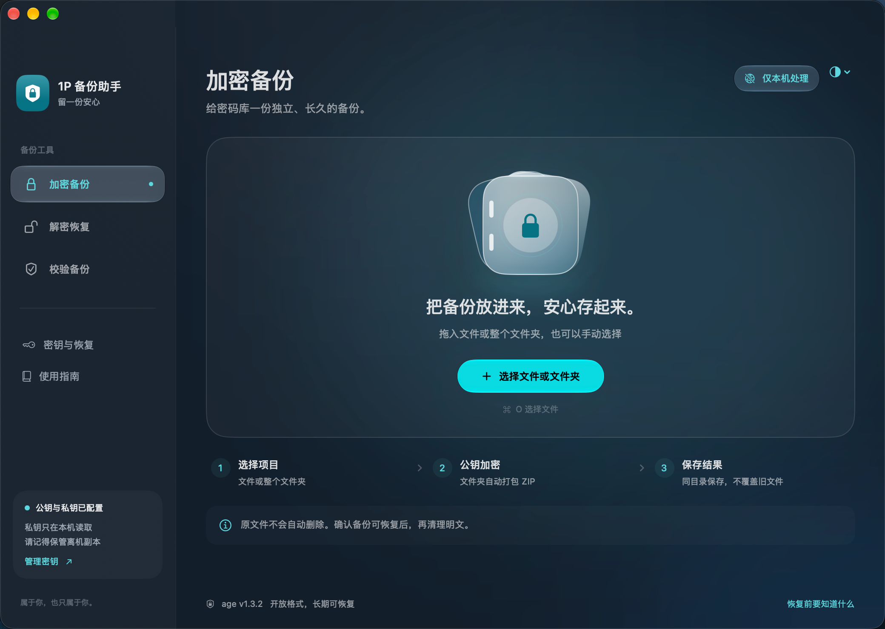
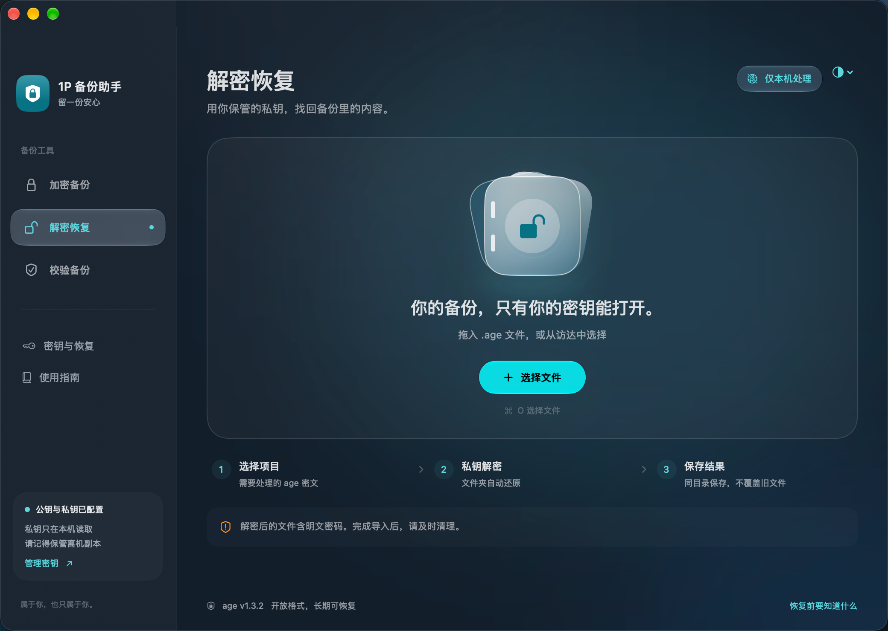
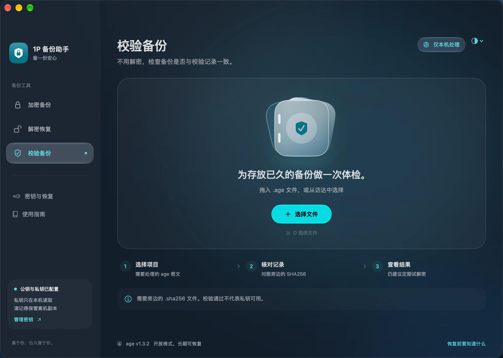
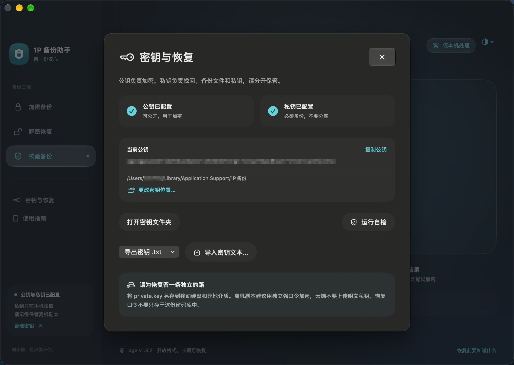
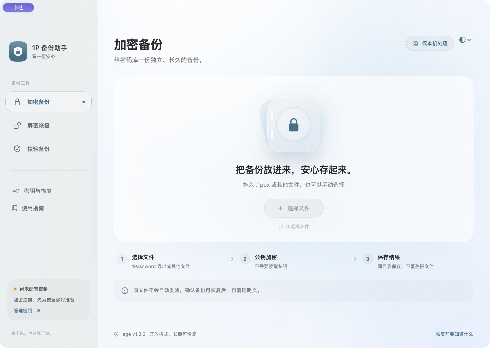
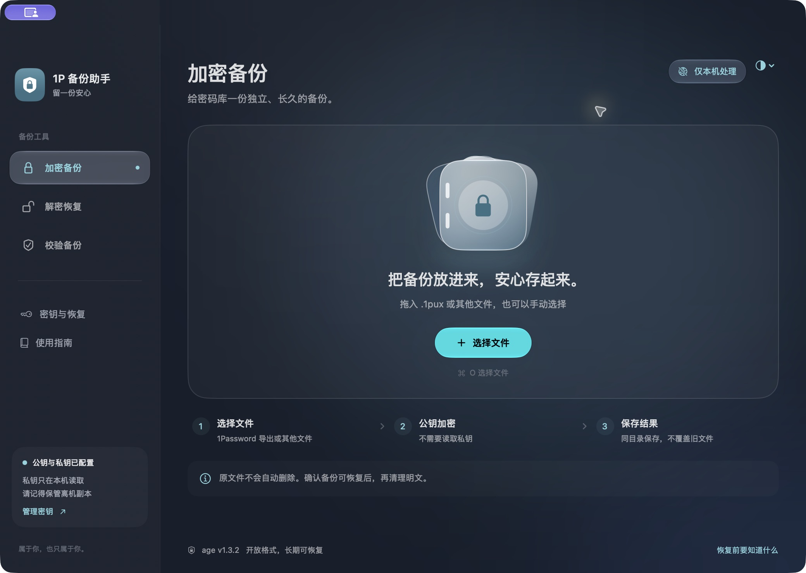

# 1P 备份助手

**给密码库留一份独立、长期可恢复的加密备份。**

一个中文原生 macOS 工具，将 [age](https://github.com/FiloSottile/age) 的加密、解密、SHA256 校验和密钥恢复放进同一个窗口。适合保存 1Password 导出的 `.1pux`，也支持其他普通文件和整个文件夹。本机处理，无需登录，不上传备份。

当前版本 **2.2** · SwiftUI / AppKit · 系统原生 Liquid Glass · age **1.3.2**

[下载应用](https://github.com/SHHBEST/onep-backup-helper/releases/latest) · [使用说明](使用说明.md) · [版本记录](CHANGELOG.md) · [安全边界](SECURITY.md)

## 功能

- **文件与文件夹加密**：公钥加密；文件夹自动打包为标准 ZIP 后生成 `.age`，无需手动压缩。
- **解密与目录恢复**：私钥解密；识别本程序的文件夹归档并恢复目录结构、隐藏文件和空目录。
- **备份校验**：生成并核对 `.sha256`，校验时不解密、不需要私钥。
- **自选密钥目录**：支持专用目录，切换到空目录可复制现有密钥，原件保留。
- **TXT 导出与恢复**：公钥、私钥分别导出；导入前识别并校验，私钥自动恢复对应公钥。
- **防止误覆盖**：已有结果和不同的现有密钥拒绝覆盖；拖入项目后仍须确认执行。
- **原生界面**：中文、拖拽、侧栏、浅色 / 深色 / 跟随系统，无浏览器运行时。

## 界面与功能

### 加密备份

拖入 `.1pux`、其他普通文件或整个文件夹，选择后确认执行。文件夹会自动打包为标准 ZIP 再用公钥加密，生成 `.age` 和 `.sha256`，不需要手动压缩。原文件保留，已有结果不会覆盖。



### 解密恢复

选择 `.age` 密文，使用本机配置的私钥恢复内容。本程序生成的文件夹归档会自动还原为文件夹；解密出的明文需妥善保管，完成恢复后再自行清理。



### 校验备份

不用解密，也不需要私钥。将 `.age` 与旁边的 `.sha256` 校验记录对照，检查长期存放或传输后的内容是否一致。校验不能代替真实解密演练，也不是数字签名。



### 密钥位置、导出与恢复

在「密钥与恢复」查看公私钥配置状态、更改保存目录、打开密钥文件夹或运行自检。公钥、私钥可以分别导出为 `.txt`，也可从文本识别并导入；导入私钥时自动恢复对应公钥。私钥 TXT 未加密，请离机妥善保管。



### 浅色与深色外观

可选择浅色、深色或跟随系统。下面两张是外观示例，功能入口以当前版本为准。

| 浅色 | 深色 |
| --- | --- |
|  |  |

截图中的公钥和用户名已遮挡，不包含私钥内容。

## 下载与使用

在 [Releases](https://github.com/SHHBEST/onep-backup-helper/releases) 下载 `onep-backup-helper-v2.2-macos-arm64.zip`，解压后将 `1P备份助手.app` 放入「应用程序」。每个版本提供下载包、说明及 `SHA256SUMS`。在下载目录校验：

```bash
shasum -a 256 -c SHA256SUMS
```

应用为本地 ad-hoc 签名，**未经过 Apple 公证**。Gatekeeper 可能拦截首次启动，请确认来源后按 macOS 提示在「隐私与安全性」中允许打开，不要关闭系统安全保护。

首次使用，在「密钥与恢复」生成密钥，备份私钥并运行自检。已有私钥时请导入原私钥，新密钥不能恢复旧备份。拖入文件或文件夹，在「加密备份」确认后生成 `.age` 与 `.sha256`；首次使用还应实际试解密一份备份。

## 系统要求

| 项目 | 要求 |
| --- | --- |
| 芯片 | Apple Silicon，arm64（M 系列） |
| 原生版最低构建目标 | macOS 26.0 |
| 已实测 | 开发机 macOS 27.0.1；尚未在 macOS 26 真机验证 |
| 其他平台 | 本界面不提供 Intel / Windows / Linux 构建；备份可由相应平台的 age 解密 |
| 运行依赖 | age 已内置，无需 Homebrew、Node.js 或额外安装包 |

经典版原包未标注最低系统版本，未额外做兼容性承诺。

## 密钥与备份

| 内容 | 用途 | 保管方式 |
| --- | --- | --- |
| `public.key` / 公钥 TXT | 加密 | 可公开；本仓库仍不含个人公钥 |
| `private.key` / 私钥 TXT | 解密、恢复公钥 | 未加密的秘密凭据；持有者可解密备份 |
| `.age` + `.sha256` | 加密备份和完整性核对 | 与私钥分开保管，定期校验与恢复演练 |

默认密钥目录为 `~/Library/Application Support/1P备份/`。目录偏好保存在 `~/Library/Application Support/1P备份助手/settings.plist`，不含密钥内容。二者均不属于应用包或源码。

私钥可以打印；从纸上恢复时，将完整密钥行准确录入 UTF-8 文本后导入。公钥不能反推出私钥。没有私钥副本时，程序无法恢复备份。详见[使用说明](使用说明.md)。

## 版本归档

| 版本 | 主要变化 | 源码保存情况 |
| --- | --- | --- |
| [经典版](https://github.com/SHHBEST/onep-backup-helper/releases/tag/v1-classic) | AppleScript 对话框；单文件加解密、自检、SHA256 校验 | 应用内后端及主脚本反编译文本 |
| [2.0](https://github.com/SHHBEST/onep-backup-helper/releases/tag/v2.0) | 原生 Liquid Glass、侧栏工作区、外观切换 | 后端及说明；完整 Swift 快照未保留 |
| [2.1](https://github.com/SHHBEST/onep-backup-helper/releases/tag/v2.1) | 文件夹加密与恢复、自选密钥目录 | 后端及说明；完整 Swift 快照未保留 |
| [2.2](https://github.com/SHHBEST/onep-backup-helper/releases/tag/v2.2) | 密钥 TXT 导出、识别、校验、导入及恢复 | 完整源码在 `源码/` |

`v1-classic` 是此次归档标签，原应用没有声明 1.0 版本号。版本标签和提交于 **2026-10-30** 根据本地留存文件导入，代表归档顺序，不代表此前已存在的 Git 开发历史。详见[版本记录](CHANGELOG.md)。

## 从源码构建

安装包含 macOS 26 或更新 SDK 的 Apple 开发工具链，在 Apple Silicon Mac 上执行：

```bash
git clone https://github.com/SHHBEST/onep-backup-helper.git
cd onep-backup-helper
bash 源码/Native/build.sh
bash 源码/Native/test.sh
```

构建到 `.build-native/1P备份助手.app`，不改动用户密钥或已安装 App。上游 age arm64 程序已在 `vendor/age/`，附校验值和 BSD-3-Clause 许可证，克隆后无需先下载应用包。编译本身不需要联网。

自动化测试在临时目录生成测试密钥，不使用个人密码库。当前验证包括原生桥接、TXT 导入导出、密钥配对及冲突、文件夹往返和 41 项后端回归；另有临时密钥的界面实测。这些检查不等于第三方安全审计。

```text
源码/Native/        原生界面、密钥管理、归档工具、构建与测试
源码/helper.sh      age 后端、校验、目录设置与覆盖保护
源码/test_helper.py 后端回归测试
版本归档/           旧应用的后端源码、元数据与说明
vendor/age/         已核验的上游程序与许可证
tools/              提交前发布内容检查
```

## 项目与许可

独立于 1Password / AgileBits，非官方产品。本工具不解析密码库内容，不替代密码管理器。age 使用公开格式；文件夹为带版本标记的标准 ZIP + age，可以用其他兼容工具恢复。

项目源码已公开供阅读，自有代码暂未指定整体开源许可证；源码公开不额外授予再分发许可。第三方依赖遵循各自许可证，见 [THIRD_PARTY_NOTICES.md](THIRD_PARTY_NOTICES.md)。
